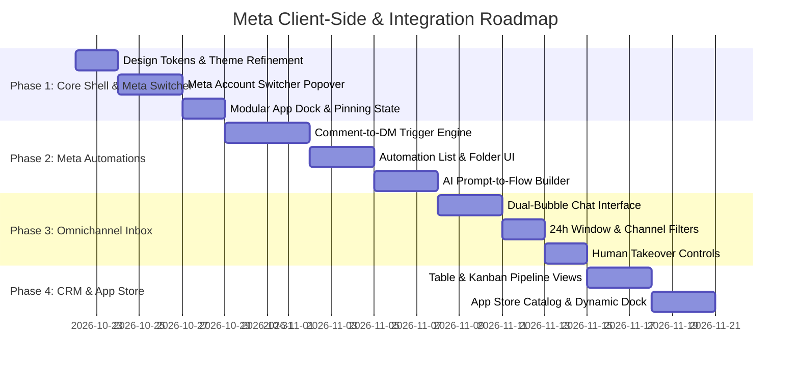

# Instantlify AI — Meta Ecosystem Client-Side Architecture & Implementation Plan

> **Product Vision**: Deliver the end-to-end automation, omnichannel inbox, workflow creation, and CRM capabilities seen in top-tier platforms (such as BooSend) while establishing an original, high-end design identity for **Instantlify AI**. Initial focus is locked on the **Meta ecosystem**: **Instagram**, **Facebook**, and **WhatsApp**.

---

## 1. Design Identity & Visual System

Instantlify AI avoids derivative copycat styling (such as generic dark modes or cartoon mascots) in favor of an **elevated, editorial SaaS aesthetic**:

| Token / Element | Instantlify AI Specification | Contrast / Purpose |
| :--- | :--- | :--- |
| **Primary Canvas** | Warm Alabaster (`#F6F7F2` to `#FAFBF7`) | Reduces eye strain; feels bespoke rather than stark white. |
| **Sidebar Theme** | Deep Forest Charcoal (`#1B221D` / `#202721`) | Premium obsidian-olive tone with high-contrast content hierarchy. |
| **Surface Cards** | Pure Soft Paper (`#FFFFFF`) with `#E2E7DE` border | Crisp `14px` border-radius, soft multi-layer shadow `0 1px 3px rgba(0,0,0,0.03)`. |
| **Brand Accent** | Sage & Deep Olive (`#3E4E42` primary, `#5C7461` hover) | Used for primary actions, active states, and growth indicators. |
| **Channel Badges** | Authentic Meta brand accents with soft container pills | • **Instagram**: Subtle gradient pill `rgba(225,48,108,0.1)` with `#E1306C`<br>• **Facebook**: Soft blue pill `rgba(24,119,242,0.1)` with `#1877F2`<br>• **WhatsApp**: Soft emerald pill `rgba(37,211,102,0.1)` with `#25D366` |
| **Typography** | `DM Sans` + `Manrope` with tabular numerical figures | Crisp readability for metrics, timestamps, and conversation threads. |

---

## 2. Meta Core Architecture

```
                                  ┌──────────────────────────────┐
                                  │       Meta Graph API         │
                                  │ (Instagram / FB / WhatsApp)  │
                                  └──────────────┬───────────────┘
                                                 │ Webhooks & OAuth
                                                 ▼
┌────────────────────────────────────────────────────────────────────────────────────────┐
│                                Instantlify Backend Services                                  │
│  ┌───────────────────────┬─────────────────────────┬────────────────────────────────┐  │
│  │ InstagramAdapter      │ MessengerAdapter        │ WhatsAppAdapter                │  │
│  │ - IG DMs & Comments   │ - FB Page DMs & Feed    │ - Cloud API Business Messages  │  │
│  └───────────────────────┴─────────────────────────┴────────────────────────────────┘  │
└────────────────────────────────────────┬───────────────────────────────────────────────┘
                                         │ REST & SSE / WebSockets
                                         ▼
┌────────────────────────────────────────────────────────────────────────────────────────┐
│                              Instantlify Client-Side (Next.js)                               │
│                                                                                        │
│  ┌──────────────────────────────────────────────────────────────────────────────────┐  │
│  │ Shell & Navigation: Multi-Account Switcher (IG Handles, FB Pages, WhatsApp No.)  │  │
│  └──────────────────────────────────────────────────────────────────────────────────┘  │
│                                                                                        │
│  ┌────────────────────┬────────────────────┬────────────────────┬───────────────────┐  │
│  │   Overview Hub     │   Automations      │  Unified Inbox     │   CRM & Contacts  │  │
│  │ - Meta Telemetry   │ - Comment Triggers │ - Dual-bubble chat │ - Channel tags    │  │
│  │ - Token Health     │ - DM Flows         │ - 24hr window tag  │ - Kanban pipeline │  │
│  │ - Growth Metrics   │ - Story Quizzes    │ - Human Handoff    │ - Meta Campaigns  │  │
│  └────────────────────┴────────────────────┴────────────────────┴───────────────────┘  │
│                                                                                        │
│  ┌──────────────────────────────────────────────────────────────────────────────────┐  │
│  │ Modular App Dock: Link-in-Bio • Content Calendar • Comment Shield • Deep Links   │  │
│  └──────────────────────────────────────────────────────────────────────────────────┘  │
└────────────────────────────────────────────────────────────────────────────────────────┘
```

---

## 3. Client-Side Component Specifications

### 3.1 Shell & Multi-Account Navigation (`components/shell.tsx`)
1. **Meta Account Switcher Popover**:
   - Replaces static dropdown with an interactive profile badge.
   - Displays avatar, handle/name (e.g. `@brand_official`, `Brand Facebook Page`), follower count, and platform badge.
   - Dropdown menu allows:
     - Switching between connected Instagram accounts, Facebook Pages, and WhatsApp numbers.
     - Live indicator showing token status (Active, Expiring Soon, Reconnect Required).
     - Direct actions: `+ Connect Meta Account` (launches OAuth) and `Refresh Tokens`.
2. **Modular App Dock ("Apps" Accordion)**:
   - Expandable section in sidebar showing user-pinned apps.
   - Pinned apps (installed via `/app-store`) appear here automatically.
   - Persistent per-workspace state stored in local storage and synced with backend.
3. **Workspace & Plan Badge**:
   - Bottom profile card showing user avatar, email, workspace role, and tier badge.

---

### 3.2 Overview & Meta Telemetry Hub (`/w/[id]/overview`)
1. **Meta Channel Connection Status Banner**:
   - Compact health ribbon showing connected Meta assets (e.g. `Instagram: Connected (@instantlify_app) • Facebook: 2 Pages • WhatsApp: 1 Number`).
2. **Key Metric Sparklines**:
   - **DM Conversations**: Graph showing daily volume across IG, FB, and WhatsApp.
   - **Contacts Captured**: Net new leads generated through comment triggers and story replies.
   - **AI Engagement Rate**: Percentage of conversations handled by AI before human handoff.
3. **Channel Performance Matrix**:
   - Quick breakdown by Meta channel (volume, response time, top converting triggers).

---

### 3.3 Meta Automations Hub (`/w/[id]/automations`)
1. **Views**: `List View` and `Folders View` (e.g. "Instagram Comment Leads", "WhatsApp Inbound", "Seasonal Promos").
2. **Meta Trigger Types**:
   - `Instagram Post/Reel Comment`: User comments keyword (e.g. "SEND") → Instantlify auto-replies to comment + sends private DM with lead magnet.
   - `Facebook Post Comment`: Auto-replies under post + initiates Messenger DM.
   - `Instagram Story Mention / Reply`: Automatically thanks user and delivers voucher or enters quiz.
   - `WhatsApp Inbound Keyword`: Direct navigation tree or AI assistant greeting.
3. **Automation Row Controls**:
   - Platform icon (IG / FB / WA), title, created date, run count, reach count.
   - Active/Inactive slide toggle.
   - Context actions: *Edit Flow*, *Duplicate*, *Transfer*, *View Analytics*, *Delete*.
4. **AI Flow Generator**:
   - Natural language input bar: *"Create an Instagram comment-to-DM workflow that asks for an email before sending a PDF guide"*.
   - Voice trigger input option.

---

### 3.4 Unified Omnichannel Inbox (`/w/[id]/inbox`)
1. **Channel Filter**:
   - Filter tabs: `All Channels`, `Instagram Direct`, `Facebook Messenger`, `WhatsApp`.
2. **24-Hour Messaging Window Indicator**:
   - Meta requires standard messages to be sent within 24 hours of user inbound. An active timer chip alerts agents to window status.
3. **Conversation Thread Design**:
   - Left pane: Contact avatar, name, channel badge, last snippet, unread dot, timestamp.
   - Right pane (Active Thread):
     - Contact details header with tags, assigned teammate, and direct channel link.
     - Inbound messages: Soft alabaster/gray rounded bubble on left.
     - Outbound AI messages: Deep forest bubble on right with an `AI Agent` badge.
     - Outbound Human Agent messages: Distinct slate bubble with agent initials.
     - System events (e.g. *"Automation Lead Magnet Triggered"*, *"Lead email captured"*).
4. **Composer**:
   - Quick reply templates, attachment upload (images, voice notes, PDFs), emoji picker, and toggle between `AI Active` and `Human Takeover`.

---

### 3.5 CRM & Contacts Hub (`/w/[id]/crm`)
1. **Dual Views**:
   - **Table View**: Comprehensive list with checkboxes, profile picture, name/handle, channel source, tags, assigned agent, message count, and stage pill.
   - **Kanban Board**: Drag-and-drop pipeline stages (`New Lead` → `Engaged` → `Qualified` → `Converted` → `Closed`).
2. **Meta Channel Badges**:
   - Clear attribution indicating whether the lead originated from IG comment, FB ad, or WhatsApp chat.
3. **Bulk Actions**:
   - Select multiple contacts → *Apply Tag*, *Change Stage*, *Send Broadcast Campaign*, *Export CSV*.

---

### 3.6 App Store & Feature Ecosystem (`/w/[id]/app-store`)
Modular feature catalog where each tool can be opened or pinned to the sidebar:
1. **Link in Bio**: Mobile-optimized bio link page with social icons, embedded forms, and product cards.
2. **Content Calendar**: Plan and schedule posts across Instagram and Facebook.
3. **Comment Shield / Hate Detection**: Automatically hide or delete spam/toxic comments on Meta posts and alert team.
4. **Smart Deep Links**: Create links that automatically open native Instagram/WhatsApp apps instead of in-app browser webviews.
5. **Web Chat Widget**: Embeddable live chat widget that syncs directly into the same inbox.

---

## 4. Backend Meta Integration Architecture

### 4.1 Required Meta Permissions & Products

| Product | Graph API Permissions | Purpose |
| :--- | :--- | :--- |
| **Instagram Graph API** | `instagram_business_basic`<br>`instagram_business_manage_messages`<br>`instagram_business_manage_comments` | Read & send DMs, read comments on posts/reels, send public comment replies. |
| **Facebook Pages / Messenger** | `pages_show_list`<br>`pages_read_engagement`<br>`pages_manage_metadata`<br>`pages_messaging` | Manage Page posts, receive comment webhooks, reply via Messenger. |
| **WhatsApp Business Platform** | `whatsapp_business_management`<br>`whatsapp_business_messaging` | Send Cloud API template messages, 2-way live chat, interactive list/button messages. |

### 4.2 Webhook Ingress Architecture
The webhook endpoint at `/api/channels/meta/webhook/` handles:
1. **`messages`**: Inbound Instagram DMs, Messenger texts, and WhatsApp messages.
2. **`messaging_postbacks`**: Quick reply clicks and CTA button interactions.
3. **`feed` / `comments`**: Live comments on Instagram posts, reels, and Facebook Page posts.
4. **Signature Verification**: Validates `X-Hub-Signature-256` using the workspace app secret.
5. **Idempotency & Deduplication**: Employs Redis cache or database unique constraints on Meta `mid` and `comment_id`.

---

## 5. Phased Implementation Plan



### Milestone Deliverables

#### Milestone 1: Navigation Shell & Meta Account Switcher
* [x] Update `components/shell.tsx` with high-end dark forest theme and responsive drawer.
* [x] Build `MetaAccountSwitcher` component supporting Instagram handles, Facebook Pages, and WhatsApp numbers.
* [x] Implement `AppStore` pinning provider so toggled apps appear under `Apps` in the sidebar.

#### Milestone 2: Meta Automations & Comment-to-DM Engine
* [x] Build `/w/[id]/automations` UI with status toggles, metrics, and search/filter chips.
* [x] Implement template import for top Meta workflows (Comment → Lead Magnet, Story Reply → Quiz, WhatsApp Lead Greeting).
* [x] Wire frontend trigger configuration to `FlowGraph` node structure.

#### Milestone 3: Unified Meta Inbox
* [x] Overhaul `/w/[id]/inbox` with multi-channel filtering (IG, FB, WhatsApp).
* [x] Implement distinct visual bubble treatments for Customer, AI Bot, and Human Agent.
* [x] Add 24-hour Meta messaging window countdown timer.

#### Milestone 4: CRM Pipeline & App Store
* [x] Build Table and Kanban views in `/w/[id]/crm` with channel badges and stage customization.
* [x] Build `/w/[id]/app-store` with cards for Link-in-Bio, Content Calendar, and Comment Shield.

### Implementation Notes (2026-10-21)

All four milestones are implemented. Where the codebase or Meta's rules required it, the build differs from the plan above:

* **Pipeline stages** use the backend's existing stages (`New lead → Qualified → Interested → Booked → Won → Lost`) rather than new ones, so existing leads, the public API and webhooks keep working.
* **Account switching** scopes the inbox to one Instagram account, Facebook Page or WhatsApp number (remembered per browser). Instagram connects through OAuth from the switcher; Facebook Pages and WhatsApp numbers connect under Integrations. "Refresh tokens" refreshes Instagram tokens; Page and WhatsApp system-user tokens are long-lived.
* **App dock pins** are stored on the workspace (`pinned_apps`) and shared by all members. All 5 apps (**Link in bio**, **Content calendar**, **Comment shield**, **Smart deep links**, and **Web chat widget**) are fully implemented, navigable, and pinnable to the sidebar dock.
* **Smart Deep Links** (`/w/[id]/deeplinks/`): Generates protocol-bypassing deep links that open natively inside Instagram, WhatsApp, YouTube, and Telegram with click metrics and QR code sharing.
* **Comment Shield** (`/w/[id]/shield/`): Provides automated keyword filtering, auto-hide, delete, and moderation logging across Instagram Reels and Facebook Page feeds.
* **Web Chat Widget** (`/w/[id]/webchat/`): Generates an embeddable script snippet with live preview, customizable accent color, and optional AI agent autoreply.
* **Integration Canvas Inspector**: Every integration tile in `/w/[id]/integrations/` includes an interactive *"What does this do?"* modal detailing how that connector functions as a node in the workflow canvas.
* **Composer Attachments**: The unified inbox composer supports attaching images, PDFs, and audio with interactive preview chips and send tracking.
* **Facebook Post Comment** triggers: Page `feed` comments are ingested and answered with a Messenger private reply. The Page must be subscribed to the `feed` webhook field. Public replies under a comment are not sent; flows reply privately.
* **Story mentions** carry no text for a keyword to match, so the story trigger is *Story reply*.
* **Unread dot** marks conversations awaiting a reply (the last message is inbound). There is no per-user read tracking.
* **Broadcasts** only send inside Meta's 24-hour window; leads outside it are skipped and counted.
* **WhatsApp text** uses `#128C4A` on its soft pill for legible contrast; `#25D366` is kept for dots and rings.
