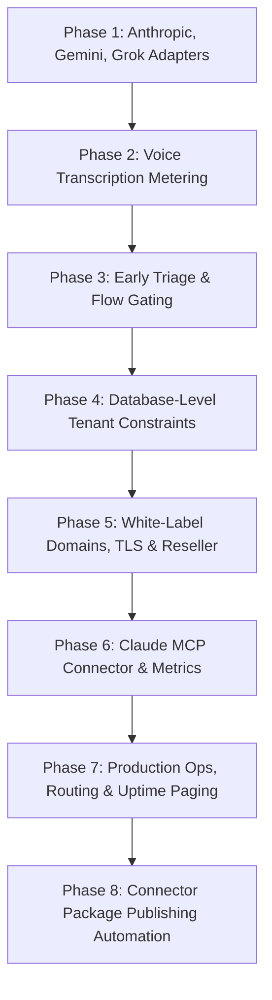
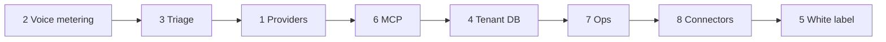

# Implementation Plan: Remaining Code Gaps (Phases 1–8)

This plan provides actionable, prompt-ready engineering specifications to resolve the remaining code items identified in [IMPLEMENTATION_STATUS.md](file:///c:/Users/OC/Desktop/Instantlify%20AI/docs/IMPLEMENTATION_STATUS.md). Each phase is self-contained with concrete design, file modifications, data models, and verification steps.

---

## User Review Required

> [!IMPORTANT]
> **Key Architecture Decisions for Review**:
> 1. **Multi-Provider Fallback & Default Models**: Model IDs come from configuration and the rate card, never hardcoded; current IDs are checked at implementation time (Anthropic defaults: `claude-sonnet-5`, `claude-haiku-4-5-20251001`). A fallback provider's call is charged at the rate of the provider that actually answered. For embeddings, OpenAI `text-embedding-3-small` remains the primary 1536-dimension vector generator to ensure vector DB compatibility.
> 2. **Tenant Isolation Strategy**: We will implement PostgreSQL composite foreign key checks and a database trigger invariant (`check_tenant_fk_isolation`) to guarantee isolation even when bypassing Django's `.save()` via `bulk_create` or `bulk_update`.
> 3. **Automated TLS**: We propose using **Caddy On-Demand TLS** (or Cloudflare SSL for SaaS) via an internal authorization endpoint `/api/v1/tls/check-domain/` that validates verified domains before certificates are issued.

---

## Open Questions

> [!NOTE]
> - **Reseller Billing Margin**: Should the reseller billing support custom markups per client workspace (e.g. Agency charges client +20%), or simply consolidate child workspace usage onto the parent agency's Stripe customer account?
> - **Voice Transcription Pricing**: Whisper is currently priced at $0.006 per minute ($0.0001 / second). We will set this as the default platform rate card for `kind="transcription"`.

---

## Proposed Changes



**Execution order (revised 2026-09-18):** 2 → 3 → 1 → 6 → 4 → 7 → 8 → 5. Small, low-risk
phases first; Phase 5 waits for the reseller answer; Phase 4 needs a PostgreSQL test run.

### Corrections to this plan (2026-09-18 review against the code)

1. Phase 1: the model IDs originally listed (`claude-3-5-sonnet-latest`, `gemini-1.5-*`,
   `grok-2`/`grok-beta`) are retired. IDs are configuration, verified when built.
2. Phase 2: the task is `crm.tasks.transcribe_message`; `process_voice_message` does not exist.
3. Phase 3: "agent" and "human" as bare keywords escalate ordinary business chat; use
   phrases ("speak to a human", "real person"). The deterministic check runs for everyone;
   the LLM classification only where AI is enabled (it spends credits). Reuse the agent's
   existing triage rather than duplicating it.
4. Phase 4: `tenants/migrations/0005` is taken (`0005_user_ban`); the migration is `0006`.
   Triggers are generated from model metadata for every tenant FK, not a hand list of six
   tables. The pytest suite runs on in-memory SQLite, so this phase adds a test run
   against the Compose PostgreSQL.
5. Phase 5: blocked on the reseller question (per-client markup vs. roll-up). TLS can only
   be exercised with mocks until production sits behind Caddy.
6. Phase 6: MCP's HTTP+SSE transport is superseded by Streamable HTTP; use the official
   MCP Python SDK. `claude_mcp_connections` is new code in `metrics.py`, not an edit.
7. Phase 8: scripts and CI can be built; actual publishing needs the Zapier, npm and Make
   accounts, and the Zapier/Make directories run their own review.



---

### Phase 1: Real AI Provider Adapters (Anthropic, Gemini, Grok)

Extend `backend/apps/agents/providers.py` from OpenAI-only to native support for Anthropic Claude, Google Gemini, and xAI Grok.

#### [MODIFY] [providers.py](file:///c:/Users/OC/Desktop/Instantlify%20AI/backend/apps/agents/providers.py)
- Create `AnthropicProvider(config)`:
  - Connects to `https://api.anthropic.com/v1/messages` with `anthropic-version: 2023-06-01`.
  - Translates Instantlify messages & tool definitions into Anthropic's `tools` and `tool_choice` format.
  - Extracts tool calls (`tool_use` blocks) and token counts (`usage.input_tokens`, `usage.output_tokens`).
- Create `GeminiProvider(config)`:
  - Connects to Google Generative Language API (`generateContent`).
  - Formats function declarations for tool use, maps `developer`/`system` instructions to `systemInstruction`.
  - Extracts `candidates[0].content` and `usageMetadata` (`promptTokenCount`, `candidatesTokenCount`).
- Create `GrokProvider(config)`:
  - Connects to `https://api.x.ai/v1/chat/completions` using OpenAI chat completion protocol with Grok model IDs (`grok-2-latest`, `grok-beta`).
- Update `provider_for(config)`:
  - Dispatch based on `config.provider` (`openai`, `anthropic`, `gemini`, `grok`).
  - Fall back to secondary configured provider if primary returns HTTP 429/503.

#### [NEW] [test_provider_adapters.py](file:///c:/Users/OC/Desktop/Instantlify%20AI/backend/tests/test_provider_adapters.py)
- Unit tests mocking HTTP responses for Anthropic, Gemini, and Grok.
- Verify message conversion, tool execution schema mapping, token extraction, and error handling.

---

### Phase 2: Voice Transcription Metering & Cost Tracking

Currently, `apps/crm/tasks.py` runs Whisper transcription via `transcribe()` and marks `UsageRecord(kind="transcription")` as complete without charging credits or recording cost.

#### [MODIFY] [voice.py](file:///c:/Users/OC/Desktop/Instantlify%20AI/backend/apps/agents/voice.py)
- Enhance `transcribe(message, config)` to measure and return both the transcript and audio duration (or estimate from byte length/audio metadata):
  ```python
  def transcribe(message, config) -> tuple[str, float]: ...
  ```

#### [MODIFY] [services.py](file:///c:/Users/OC/Desktop/Instantlify%20AI/backend/apps/billing/services.py)
- Add `charge_transcription(config, record, duration_seconds)`:
  - Calculates cost using rate from `ModelPricingRate` (default $0.006/min = $0.0001/sec).
  - Debits platform credits ledger if `billing_mode == "platform_credits"` with key `usage:{record.id}:transcribe`.
  - Updates `record.cost`, `record.status = "complete"`.

#### [MODIFY] [tasks.py](file:///c:/Users/OC/Desktop/Instantlify%20AI/backend/apps/crm/tasks.py)
- In `transcribe_message`:
  - Call `text, duration = transcribe(message, config)`.
  - Call `charge_transcription(config, usage, duration)`.

#### [MODIFY] [test_team_and_inbound.py](file:///c:/Users/OC/Desktop/Instantlify%20AI/backend/tests/test_team_and_inbound.py)
- Assert `UsageRecord` for transcription records measured `cost > 0` and credit ledger balance decreases.

---

### Phase 3: Early Inbound Message Triage & Automation Gating

Sentiment/urgency triage currently only runs inside the LangGraph agent (`apps/agents/runtime.py`). An incoming message matching an automation keyword triggers the automation flow immediately, preventing human intervention for upset or high-intent leads.

#### [NEW] [triage.py](file:///c:/Users/OC/Desktop/Instantlify%20AI/backend/apps/crm/triage.py)
- Extract lightweight triage logic:
  - Step 1: Fast deterministic check for escalation phrases (`refund`, `chargeback`, `lawyer`, `fraud`, `speak to a human`, `real person`, `your manager`); bare "agent"/"human" are excluded.
  - Step 2: If `config.triage_enabled`, execute fast LLM classification returning `{"sentiment": "positive|neutral|angry", "urgency": "low|normal|urgent", "intent": "..."}`.
  - Returns `TriageResult(should_escalate=bool, sentiment=str, urgency=str, intent=str)`.

#### [MODIFY] [services.py](file:///c:/Users/OC/Desktop/Instantlify%20AI/backend/apps/crm/services.py)
- In `handle_inbound(msg, lead, payload)`:
  - Run `triage_result = evaluate_inbound_triage(msg)`.
  - If `triage_result.should_escalate`:
    - Set `conversation.status = "needs_human"` or tag lead.
    - Skip `route_message(msg, payload)` to prevent inappropriate canned bot responses.
    - Dispatch WebSocket team alert and optional Slack notification.
  - If clean: proceed to `route_message(msg, payload)`.

#### [NEW] [test_early_triage.py](file:///c:/Users/OC/Desktop/Instantlify%20AI/backend/tests/test_early_triage.py)
- Verify an angry message matching an automation trigger bypasses the bot and escalates to the inbox.

---

### Phase 4: Database-Level Tenant Isolation Constraints

Tenant isolation currently relies on `TenantModel.save()` in Python. Bulk operations (`bulk_create`, `bulk_update`) bypass `save()`.

#### [NEW] [0006_tenant_database_constraints.py](file:///c:/Users/OC/Desktop/Instantlify%20AI/backend/apps/tenants/migrations/0006_tenant_database_constraints.py)
- Create PostgreSQL trigger function `enforce_tenant_foreign_key_isolation()`:
  - Inspects all foreign keys referencing tenant models.
  - Invariant: `NEW.workspace_id = TARGET.workspace_id`.
  - Raises exception on mismatch: `SQLSTATE '23503' (foreign_key_violation): cross_tenant_fk_violation`.
- Generate triggers from model metadata for every FK between two tenant models (not a hand-picked list), skipped on non-PostgreSQL databases.

#### [MODIFY] [models.py](file:///c:/Users/OC/Desktop/Instantlify%20AI/backend/apps/tenants/models.py)
- Enhance `TenantManager` and `TenantModel` to validate workspace IDs in `bulk_create` and `bulk_update`.

#### [NEW] [test_tenant_db_isolation.py](file:///c:/Users/OC/Desktop/Instantlify%20AI/backend/tests/test_tenant_db_isolation.py)
- Test that executing `bulk_create` with cross-tenant foreign keys raises a database constraint error.

---

### Phase 5: White-Label Custom Domains, Automated TLS & Reseller Billing

Enhance custom domain functionality to handle ownership verification, automated TLS certificates, and reseller account aggregation.

#### [MODIFY] [models.py](file:///c:/Users/OC/Desktop/Instantlify%20AI/backend/apps/tenants/models.py)
- Extend `WorkspaceBranding`:
  - `custom_domain_status = models.CharField(choices=["pending", "active", "failed"], default="pending")`
  - `verification_token = models.CharField(max_length=64, blank=True)`
  - `verified_at = models.DateTimeField(null=True, blank=True)`
  - `tls_status = models.CharField(choices=["inactive", "issuing", "active", "error"], default="inactive")`

#### [NEW] [domain_verification.py](file:///c:/Users/OC/Desktop/Instantlify%20AI/backend/apps/tenants/domain_verification.py)
- Service `verify_custom_domain(workspace_branding)`:
  - Queries DNS for TXT record `_instantlify-challenge.<custom_domain>` or CNAME `instantlify.com`.
  - Updates `custom_domain_status = "active"` upon resolution.

#### [NEW] [tls.py](file:///c:/Users/OC/Desktop/Instantlify%20AI/backend/apps/tenants/tls.py)
- Endpoint `GET /api/v1/tls/check-domain/?domain=<host>`:
  - Internal endpoint queried by Caddy (`on_demand_tls { ask http://backend:8000/api/v1/tls/check-domain/ }`).
  - Returns HTTP 200 only if the domain is verified and active in `WorkspaceBranding`.

#### [NEW] [reseller.py](file:///c:/Users/OC/Desktop/Instantlify%20AI/backend/apps/billing/reseller.py)
- Support consolidated billing:
  - If `workspace.parent` is set, child workspace subscription and usage charges roll up to the parent agency's `BillingAccount` and Stripe Customer.

#### [NEW] [test_custom_domains_and_reseller.py](file:///c:/Users/OC/Desktop/Instantlify%20AI/backend/tests/test_custom_domains_and_reseller.py)
- Test DNS verification workflow, Caddy TLS ask endpoint, and parent agency billing rollup.

---

### Phase 6: Claude Model Context Protocol (MCP) Server Connector

Provide a native MCP server for Claude Desktop / Claude Agents and illuminate the dashboard card.

#### [NEW] [mcp/](file:///c:/Users/OC/Desktop/Instantlify%20AI/backend/apps/public_api/mcp/)
- Implement an MCP server with the official MCP Python SDK over Streamable HTTP (the older HTTP+SSE transport is superseded):
  - `server.py`: a single `/api/mcp/` endpoint authenticated with a workspace API key.
  - `tools.py`: Expose core Instantlify tools:
    - `list_conversations(status, limit)`
    - `send_message(conversation_id, text)`
    - `get_lead_details(lead_id)`
    - `get_workspace_metrics(window_days)`
    - `trigger_automation(automation_id, recipient)`
- `models.py`: Add `MCPConnection(workspace, client_identifier, last_active_at, created_at)` to track active MCP clients.

#### [MODIFY] [metrics.py](file:///c:/Users/OC/Desktop/Instantlify%20AI/backend/apps/platform_ops/metrics.py)
- Update `claude_mcp_connections` in `PlatformMetricsService`:
  - Replace empty/dash placeholder with `MCPConnection.objects.filter(last_active_at__gte=recent).count()`.

#### [NEW] [test_mcp_connector.py](file:///c:/Users/OC/Desktop/Instantlify%20AI/backend/tests/test_mcp_connector.py)
- Test MCP SSE handshake, tool discovery, tool execution with API key, and metrics counting.

---

### Phase 7: Production Operations, Routing & Webhook Uptime Monitoring

Formalize reverse proxy production routing and implement active webhook uptime paging.

#### [NEW] [Caddyfile](file:///c:/Users/OC/Desktop/Instantlify%20AI/deploy/Caddyfile) & [nginx.conf](file:///c:/Users/OC/Desktop/Instantlify%20AI/deploy/nginx.conf)
- Reverse proxy configs with:
  - WebSocket proxying (`/ws/`) to ASGI with connection upgrade headers.
  - Streaming media proxying (`/media/voice/`) with byte-range and buffering options.
  - Ingress webhook rate limiting and headers (`/webhooks/`).
  - Automatic on-demand TLS via Caddy `ask` endpoint.

#### [NEW] [uptime.py](file:///c:/Users/OC/Desktop/Instantlify%20AI/backend/apps/platform_ops/uptime.py)
- Periodic Celery task `probe_webhook_uptime`:
  - Sends synthetic ping to channel ingress endpoints and checks DB/Redis health.
  - Dispatches incident alert (PagerDuty / Opsgenie / Slack webhook) if latency > 2500ms or HTTP 5xx occurs.
  - Monitors DLQ (dead letter queue) depth for poisoned webhooks.

#### [NEW] [test_uptime_monitoring.py](file:///c:/Users/OC/Desktop/Instantlify%20AI/backend/tests/test_uptime_monitoring.py)
- Test synthetic health check execution and alert dispatch when endpoint simulates failure.

---

### Phase 8: Connector Package Publishing Automation (Zapier, n8n, Make)

Package, validate, and automate publishing for `connectors/` to their public app directories.

#### [NEW] [publish.py](file:///c:/Users/OC/Desktop/Instantlify%20AI/connectors/scripts/publish.py)
- Automation script for release publishing:
  - **Zapier**: Run `zapier test`, `zapier validate`, bump version in `package.json`, run `zapier push`.
  - **n8n**: Validate community node structure, run `npm run build`, `npm pack`, verify export signatures, publish to npm registry.
  - **Make**: Schema validator checking `base.json`, `connections/`, `webhooks/`, and `modules/*.json` against Make App Schema spec.

#### [NEW] [connectors.yml](file:///c:/Users/OC/Desktop/Instantlify%20AI/.github/workflows/connectors.yml)
- CI workflow running tests on connector packages on pull request and automated publishing on GitHub Release tag.

---

## Verification Plan

### Automated Tests
1. **Providers**: `pytest backend/tests/test_provider_adapters.py -v`
2. **Voice Metering**: `pytest backend/tests/test_team_and_inbound.py -k voice -v`
3. **Early Triage**: `pytest backend/tests/test_early_triage.py -v`
4. **Tenant Constraints**: `pytest backend/tests/test_tenant_db_isolation.py -v`
5. **White Label & Reseller**: `pytest backend/tests/test_custom_domains_and_reseller.py -v`
6. **Claude MCP**: `pytest backend/tests/test_mcp_connector.py -v`
7. **Uptime Alerts**: `pytest backend/tests/test_uptime_monitoring.py -v`
8. **Full Backend Suite**: `pytest backend/tests/ -v`

### Manual Verification
1. **Claude Desktop Integration**: Connect Claude Desktop to `http://localhost:8000/api/mcp/` with a workspace API key, execute tool queries, and confirm the Console dashboard reflects the connection.
2. **Custom Domain Challenge**: Create custom domain with test TXT record, trigger verification, and verify Caddy returns 200 on TLS inquiry.
3. **Escalation Gating**: Send an inbound message "I demand a refund immediately" containing an automation keyword; verify the automation does not trigger and conversation flags for human agent.
